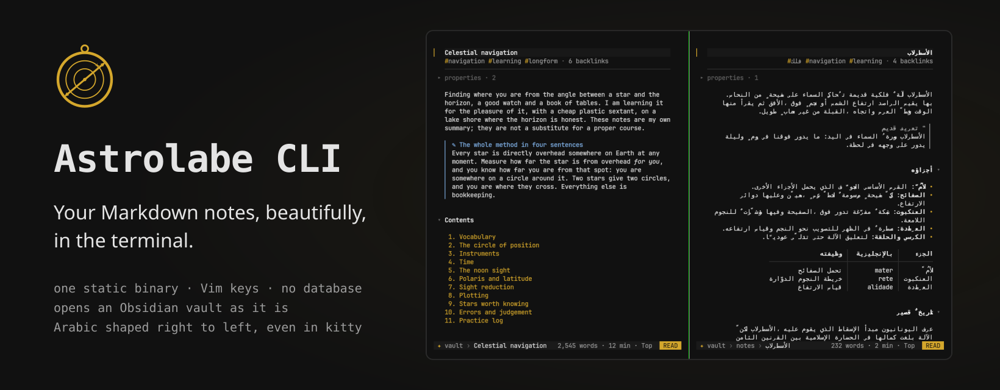
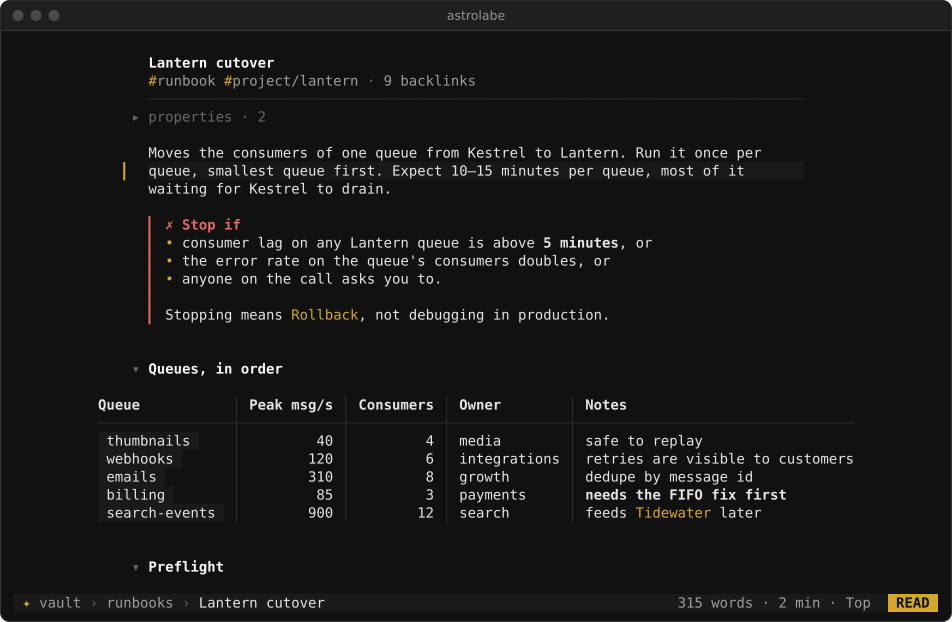

<p align="center"></p>

# astrolabe-cli

Terminal reader, Vim-style editor and shell verbs for a folder of Markdown
notes. One static binary; opens an Obsidian or
[Astrolabe](https://github.com/ZahakJ/astrolabe) vault as it is.



## Install

```sh
curl -fsSL https://raw.githubusercontent.com/ZahakJ/astrolabe-cli/main/install.sh | sh
```

Installs `astrolabe` and the alias `ast` into `~/.local/bin`, no root. Or take
a binary from [Releases](https://github.com/ZahakJ/astrolabe-cli/releases), or
[build from source](docs/building.md).

## Usage

```sh
astrolabe -C ~/notes                  # open a vault; it is remembered
astrolabe                             # today's note, else the last one
astrolabe "Lantern migration"         # open a note by title, path or alias
astrolabe add "call the plumber"      # append a line to today's note
astrolabe add -t "renew passport due:2026-11-02"
astrolabe find 'tag:runbook rollback' # path:line:text
astrolabe tasks --due
nvim "$(astrolabe pick)"
astrolabe doctor                      # terminal, vault and config check
```

In the reader: `j` `k` move, `]]` `[[` jump headings, `za` folds, `Tab`
`Enter` follow links, `i` edits, `x` toggles a task, `Ctrl-p` finds a note,
`Space /` searches the vault, `?` lists every key, `q` quits. `examples/vault`
is a sample vault to try it on.

Documentation: [manual](https://zahakj.github.io/astrolabe-cli/manual/),
[keymap](docs/keymap.md), [shell reference](docs/cli.md),
[configuration](docs/configuration.md), [terminals](docs/terminals.md),
[vaults and Obsidian](docs/obsidian.md), [shell, tmux and Neovim](docs/integration.md),
[internals](docs/internals.md).

## License

MIT
